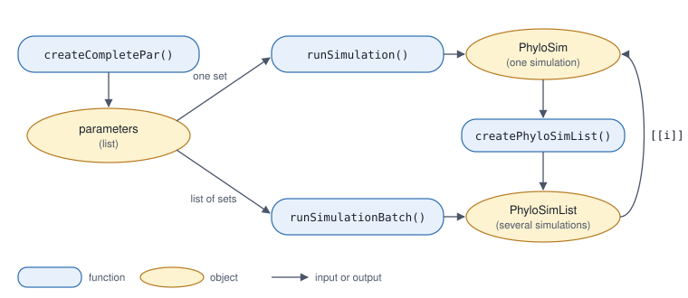
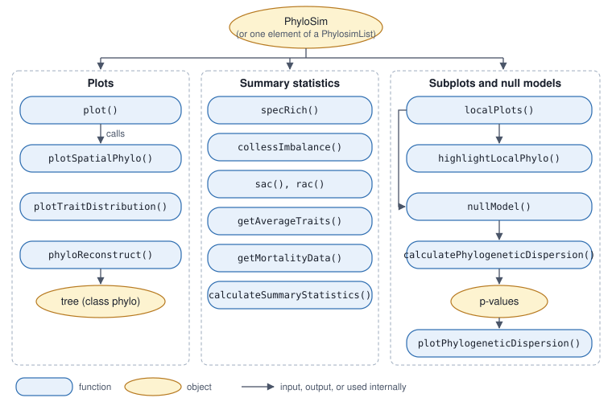

```{r setup, include = FALSE}
knitr::opts_chunk$set(
  collapse = TRUE,
  comment = "#>",
  fig.align = "center",
  fig.height = 4,
  fig.width = 4
)
```

```{css, echo = FALSE, file = "ecophylosim.css"}
```

```{js, echo = FALSE, file = "ecophylosim.js"}
```

<div class="abstract">
**Abstract.** EcoPhyloSim simulates the joint ecological and evolutionary dynamics
of a species community in space. Individuals on a grid die and are replaced by
offspring that disperse locally or globally, inherit and evolve traits, and are
selected by the environment and by competition with their neighbors, while new
species arise by speciation. The simulation records the spatial distribution of
the species, their traits and their phylogeny, and the package provides
functions to plot and summarize these outputs, such as species–area curves,
rank–abundance curves and measures of phylogenetic structure. This vignette
shows how to run the model, analyze its output and fit it to data. The
processes of the model, its equations and the patterns it produces are
described in the vignette "EcoPhyloSim model"
(`vignette("ModelDescription", package = "EcoPhyloSim")`), and how its results
changed between releases in the vignette "Model history"
(`vignette("ModelHistory", package = "EcoPhyloSim")`).
</div>

# Quick start

A simulation on a grid of 50 × 50 cells with local dispersal, run for 1,000
generations:

```{r quickstart, results = 'hide', fig.width = 7, fig.height = 5, fig.cap = "Result of the quick-start simulation (50 × 50 cells, dispersal 1, specRate 2, no environmental filtering or density dependence) after 1,000 generations, shown by plot(): phylogeny of the extant species (left), mean environment and traits of the species (middle) and the species of each cell (right). Each species has the same color in the phylogeny and the map, and related species have similar colors."}
library(EcoPhyloSim)
pars <- createCompletePar(x = 50, y = 50, dispersal = 1, runs = 1000,
                          specRate = 2, seed = 1)
simu <- runSimulation(pars)
plot(simu)
```

`createCompletePar()` collects the parameters of the model, `runSimulation()`
runs it, and `plot()` shows the phylogeny of the species, their mean traits and
their spatial distribution; the following chapters explain each step.

## Citation

To cite the package, use the citation information provided with the package:

```{r citation}
citation("EcoPhyloSim")
```

# Running the model

## Installation

The package is not on CRAN yet. Follow the instructions on
<https://github.com/TheoreticalEcology/EcoPhyloSim> to install the development
version, e.g.

```{r install, eval = FALSE}
remotes::install_github(repo = "TheoreticalEcology/EcoPhyloSim",
                        subdir = "PhyloSim",
                        dependencies = TRUE,
                        build_vignettes = TRUE)

?EcoPhyloSim
browseVignettes("EcoPhyloSim")
```

## Running a simulation

Running the model has two steps. First, `createCompletePar()` creates the list
of parameters:

```{r createpar}
pars <- createCompletePar(x = 50, y = 50, dispersal = 1, runs = c(500, 1000),
                          environment = 1, specRate = 2, seed = 42)
```

This creates one simulation on 50 × 50 cells, recorded after 500 and 1,000
generations. With `dispersal = 1`, the offspring that replaces a dead
individual comes from a parent near its cell, and environmental filtering
(`environment`) favors individuals whose environmental trait matches the
environment of their cell. All parameters are listed with their
defaults and ranges in `?createCompletePar`; the vignette "EcoPhyloSim model"
(`vignette("ModelDescription", package = "EcoPhyloSim")`) explains the
processes they control and lists known limitations (e.g. `dispersal` has an
effect only in steps of 0.5). Besides the model parameters,
`createCompletePar()` has arguments that control the run and its output:

| Argument | Meaning | Default |
|---|---|---|
| `runs` | generation(s) at which the state is recorded; values must not decrease | 100 |
| `seed` | random seed; if `NULL`, a seed is drawn and stored in `$Model$seed` of the result | `NULL` |
| `prunePhylogeny` | if `TRUE`, the phylogeny contains only the extant species; if `FALSE`, also all extinct species as tips | `TRUE` |
| `convertToBinaryTree` | resolve polytomies of the phylogeny (deterministically, with `ape::multi2di(random = FALSE)`) | `TRUE` |
| `calculateSummaries` | calculate summary statistics (`calculateSummaryStatistics()`) for the last recorded generation | `FALSE` |
| `scenario` | a label stored with the parameters | `NULL` |

Table: Arguments of `createCompletePar()` that control the run and its output, not the model.

The list of parameters is then used to run the simulation:

```{r runsim, results = 'hide'}
simu <- runSimulation(pars)
```

This simulation took `r round(simu$Model$runtime, 1)` seconds. Note that 1,000
generations are enough for a first look, but some outputs, in particular with
density dependence and the phylogeny, need tens of thousands of generations to
reach equilibrium (see Time to equilibrium in the vignette "EcoPhyloSim model").

The result is an object of class `PhyloSim` with two lists: `$Model` contains
the parameters of the run, and `$Output` contains one element per generation
in `runs`, here two. Each of them contains:

| Element | Content |
|---|---|
| `specMat` | species of each cell (matrix with $y$ rows and $x$ columns) |
| `traitMat`, `compMat`, `neutMat` | environmental, competition and neutral trait of each cell |
| `envMat` | environment of each cell |
| `phylogeny` | phylogeny of the species (class `phylo` of the package ape; 0 if only one species is left) |
| `phyloTXT` | the phylogeny as Newick text |
| `summaries` | summary statistics if `calculateSummaries = TRUE`, stored in the first element of `$Output` only |

Table: Elements of each recorded generation in `$Output` of a `PhyloSim` object.

```{r output1}
str(simu$Output[[1]], max.level = 1)
```

## Several simulations

`runSimulationBatch()` runs a list of parameter sets, optionally in parallel, and returns an object of
class `PhylosimList`, which is essentially a list of `PhyloSim` objects. In the
following example, two slightly different parameter sets are run one after
the other; for larger batches, `parallel = 2` runs them on two cores.

```{r runbatch, results = 'hide'}
pars1 <- createCompletePar(x = 50, y = 50, dispersal = 1, runs = 1000,
                           environment = 0.5, specRate = 2, seed = 1)
pars2 <- createCompletePar(x = 50, y = 50, dispersal = 1, runs = 1000,
                           environment = 1, specRate = 2, seed = 2)
simuBatch <- runSimulationBatch(list(pars1, pars2), parallel = FALSE)
```

The single simulations can be accessed by indexing, e.g. `simuBatch[[1]]`.

```{r runfig, echo = FALSE, out.width = "80%", fig.cap = "Functions (boxes) and objects (ellipses) to run simulations. A single PhyloSim object is taken from a PhylosimList by indexing."}

```

# Plots and summary statistics

This chapter explains the functions that plot and summarize the output of a
simulation. All of them take a `PhyloSim` object and use its last recorded
generation unless `which.result` is given, except `getMortalityData()`, which
uses all recorded generations; some also accept a `PhylosimList`.
The table gives an overview; the chapter Community patterns of the vignette
"EcoPhyloSim model" shows how these patterns respond to the processes of the
model.

| Function | Shows or returns | Typical question |
|---|---|---|
| `plotSpatialPhylo()` | phylogeny, mean traits and map of the species | Which species live where, and how are they related? |
| `plotTraitDistribution()` | traits against the environment, in space and per species | Do traits match the environment? Are competition traits spread out? |
| `sac()` | species–area curve | How fast do species accumulate with the sampled area? |
| `rac()` | rank–abundance curve | How even are the abundances? |
| `phyloReconstruct()` | tree clustered from the neutral traits | How much does trait similarity tell about relatedness? |
| `highlightLocalPhylo()` | species of a subplot in the tree of the whole grid | Are the species of a local community related? |
| `specRich()`, `collessImbalance()` | single statistics | How many species? How balanced is the tree? |
| `calculateSummaryStatistics()` | a set of statistics | Summaries for comparisons and calibration |
| `localPlots()` | random subplots (an observation model) | What would a field survey see? |
| `getMortalityData()` | death and conspecific neighbors of each individual | How strong is conspecific density dependence? |
| `nullModel()`, `calculatePhylogeneticDispersion()` | phylogenetic dispersion against random communities | Are local communities phylogenetically clustered or overdispersed? |

Table: Functions to plot and summarize a simulation, what they return and which question they answer.

```{r plotsfig, echo = FALSE, out.width = "90%", fig.cap = "Functions (boxes) to plot and summarize a simulation, and the objects (ellipses) they return. Arrows within a group show which function uses the output of another or calls it internally."}

```

## Plot functions

**`plotSpatialPhylo()`** is the default plot method for a `PhyloSim` object and
gives a first overview of a simulation. Each species has the same color in the
phylogeny and in the map, and related species have similar colors; the middle
panel shows the mean environment and traits of the species (point size), in
the order of the tips. *How to read it:* in the map, patches of one color show
spatial aggregation, which local dispersal creates even in the neutral model;
colors that follow the environmental gradient show environmental filtering. The
middle panel shows whether related species have similar traits.

```{r plotspatialphylo, fig.width = 7, fig.height = 5, fig.cap = "plotSpatialPhylo() for the simulation of the section Running a simulation (50 × 50 cells, dispersal 1, environment 1, specRate 2) after 1,000 generations: phylogeny of the extant species (left), mean environment and traits of the species in the order of the tips (middle) and the species of each cell (right), with the colors of the phylogeny. The arguments plot and plotTraits select the panels."}
plotSpatialPhylo(simu)
```

**Species–area curve:** `sac()` computes the mean number of species in square
subplots of increasing size, placed at random in the grid. *How to read it:* on
log–log axes, the slope tells how fast new species appear with area. Spatial
aggregation (local dispersal) makes small subplots poor in species, so the
curve is flat at small areas and steep at large areas; with global dispersal, subplots are close to random samples of the
whole grid and the curve flattens early.

```{r sac, results = 'hide', fig.width = 4.5, fig.height = 4.5, fig.cap = "Species–area curve of the same simulation (sac()): mean number of species in randomly placed square subplots against their area in cells (both axes logarithmic); grey band and dashed lines: 5% and 95% quantiles across subplots. Its shape depends on dispersal and spatial aggregation (see the vignette 'EcoPhyloSim model')."}
sac(simu, title = "")
```

**Rank–abundance curve:** `rac()` shows the abundance of each species in the
whole grid against its rank. *How to read it:* a steep curve means that a few
species dominate, a flat one that abundances are even; the length of the curve
is the number of species. Density dependence is expected to flatten the curve,
as it favors rare species.

```{r rac, results = 'hide', fig.width = 4.5, fig.height = 4.5, fig.cap = "Rank–abundance curve of the same simulation (rac()): number of individuals of each species in the whole grid against its rank (most abundant species = rank 1). The vignette 'EcoPhyloSim model' compares such curves with the expectation of neutral theory."}
rac(simu, title = "")
```

**Trait plots:** `plotTraitDistribution()` shows the three traits of the
individuals. *How to read it:* with environmental filtering, the environmental
trait follows the environment (points along the diagonal in the top panel); with
density dependence, the competition traits of neighbors differ, and they can
move to the ends of the trait range (see Negative density dependence in the
vignette "EcoPhyloSim model"). The neutral trait changes only by drift and serves as a
reference.

```{r traitdist, fig.width = 7, fig.height = 6, fig.cap = "plotTraitDistribution() for the same simulation: environmental, competition and neutral trait (columns) of all individuals against the environment of their cell (top), their spatial distribution (middle) and their histograms per species (bottom; colors as in plotSpatialPhylo()). With environment = 1, the environmental trait follows the environment."}
plotTraitDistribution(simu, type = "all")
```

**Reconstructed phylogenies:** `phyloReconstruct()` clusters the species by the
mean of their neutral trait (hierarchical clustering with `hclust()`). As the
neutral trait changes only by drift (unless `traitSpeciationJump` changes it at
speciation), comparing the result with the true phylogeny shows how much
phylogenetic signal such a trait carries.

```{r phylorecon, fig.width = 7, fig.height = 4, fig.cap = "Phylogeny of the same simulation reconstructed from the mean neutral traits of the species with phyloReconstruct() (left) and the true phylogeny of the extant species (right)."}
reconstructed <- phyloReconstruct(simu)
true <- simu$Output[[length(simu$Output)]]$phylogeny

op <- par(mfrow = c(1, 2))
plot(reconstructed, main = "Reconstructed phylogeny", show.tip.label = FALSE)
plot(true, main = "True phylogeny", show.tip.label = FALSE)
par(op)
```

**Highlight local communities:** `highlightLocalPhylo()` highlights the species
of a local community, a randomly placed subplot, in the phylogeny of the whole
grid (the metacommunity). *How to read it:* highlighted species that sit in a
few clades indicate phylogenetic clustering, species spread over the whole tree
overdispersion; the null models below test this.

```{r highlight-large, fig.width = 6, fig.height = 4.5, fig.cap = "highlightLocalPhylo() for the same simulation: phylogeny of all extant species in the grid (the metacommunity), with the species of one randomly placed subplot of 10 × 10 cells (the local community) in black, with thicker branches and their species numbers."}
highlightLocalPhylo(simu, size = 10, n = 1, title = "")
```

## Summary statistics

Single statistics of a simulation can be calculated directly, e.g. the number
of species and the Yule-normalized Colless index of the phylogeny (about 0 for
a tree as balanced as expected under a Yule process, positive for more
imbalanced trees):

```{r stats}
specRich(simu)
collessImbalance(simu, norm = "yule")
```

`calculateSummaryStatistics()` computes a set of statistics at once, e.g. to
compare simulations or to fit the model to data (see the chapter Fitting the
model to data). It takes some seconds, as the phylogenetic dispersion is
computed with a null model; with `calculateSummaries = TRUE` in
`createCompletePar()`, `runSimulation()` computes them for the last recorded
generation.

```{r summarystats, eval = FALSE}
calculateSummaryStatistics(simu)
```

::: {.grouped}
| Group | Statistic | Meaning |
|---|---|---|
| Diversity | `gammaDiversity`, `alphaDiversity`, `betaDiversity` | species in the grid, mean species in subplots, turnover between subplots |
| Abundances and space | `racAuc`, `sacAuc` | area under the rank–abundance and species–area curves |
| | `ce`, `nb8` | spatial aggregation of the species: mean Clark–Evans index over the species, and an index of conspecifics among the 8 neighboring cells |
| Traits and environment | `envSorting` | share of the variance of the environment explained by species identity (0 if all species occupy the same mix of environments, 1 if each species occupies one environment; see `?calculateSummaryStatistics`) |
| | `varPart_1`, `varPart_2` | variance of the community composition explained by environment and by competition traits |
| Phylogeny | `imbalance`, `gammaStatistics` | Colless index and gamma statistic (negative: branching slows down towards the present) |
| | `meanNodeAge`, `dispersion` | mean branch length; standardized phylogenetic dispersion of subplots (SES of the MPD) |

Table: Summary statistics returned by `calculateSummaryStatistics()`, grouped by the pattern they describe.
:::

The phylogenetic statistics use the tree of the extant species. Several
statistics use random subplots; call `set.seed()` first for reproducible values
(`?calculateSummaryStatistics` gives the details).

Several functions, such as species–area curves and the null models below, are
based on `localPlots()`, a simple observation model that creates random
subplots of a given size within the metacommunity and returns their species,
environment and competition traits and positions:

```{r localplots}
str(localPlots(simu, size = 10, n = 2), max.level = 1)
```

**Mortality data:** `getMortalityData()` returns, for each individual, the number
of its conspecific neighbors and whether it died before the next recorded
generation, which allows estimating conspecific negative density dependence
as in field studies (see Density dependence measured from mortality in
the vignette "EcoPhyloSim model"). For this, the state
should be recorded in consecutive generations:

```{r mortality-run, results = 'hide'}
simuM <- runSimulation(createCompletePar(x = 30, y = 30, dispersal = 1, negativeDD = 1,
                                         runs = c(4000, 4001), seed = 3))
```

```{r mortality}
mort <- getMortalityData(simuM)
head(mort)
```

## Null models

Phylogenetic patterns of local communities are only meaningful against what
random communities would show. `nullModel()` places subplots in the
metacommunity and compares their mean pairwise phylogenetic distance (MPD) with
that of random communities of the same size, drawn from the abundances of the
species in the whole grid (`abundance = FALSE`, the default) or in all sampled
subplots together (`abundance = TRUE`):

```{r nullmodel}
pValues <- nullModel(simu = simu, abundance = FALSE, localPlotSize = 10,
                     numberOfPlots = 20, repetitions = 100, fun = "mpd")
round(pValues, 2)
```

Each value is the share of random communities whose MPD is at most the
observed one. Small values mean that the species of a subplot are more closely
related than expected by chance (phylogenetic clustering), large values that
they are less closely related (phylogenetic overdispersion). Such p-values, and
standardized effect sizes (SES) computed in the same way, depend on the size of
the subplots and on the null model (which species pool, whether abundances are
used); compare only values computed with the same settings.

**`calculatePhylogeneticDispersion()`:** this and its associated plot function
are convenience functions: they calculate
null models for all runs in a `PhylosimList` object and for different plot
sizes. Which null model is used is determined by the `type` argument:

- `"PhylMeta"`: equivalent to `nullModel()` with `abundance = FALSE`.
- `"PhylSample"`: equivalent to `nullModel()` with `abundance = TRUE`.
- `"PhylPool"`: uses `picante::ses.mpd()` with `null.model = "phylogeny.pool"`.
- `"SamplePool"`: uses `picante::ses.mpd()` with `null.model = "sample.pool"`.

```{r calcphyldis, eval = FALSE}
pValuesBatch <- calculatePhylogeneticDispersion(simuBatch, plotlengths = 3,
                                                plots = 20, replicates = 20,
                                                type = "PhylMeta")
```

The result can be visualized with `plotPhylogeneticDispersion()`. The figure
uses example results stored in the package (`pPD.pvalues`, `pPD.positions`);
they illustrate the plot only.

```{r plotphyldis, fig.width = 6, fig.height = 5, fig.cap = "plotPhylogeneticDispersion() for the example data pPD.pvalues: one simulation of 50,000 generations on 50 × 50 cells for each of four dispersal settings (rows: global or dispersal distance) and seven combinations of environmental filtering and density dependence (columns; upper labels: strength of environment, lower labels: strength of negativeDD): neither, a gradient from filtering only to density dependence only, and both; analysed with the null model 'PhylMeta' (200 subplots per size). In each square, the line shows the median p-value against the subplot size (2 to 10 cells per side), the band the interquartile range; the color shows the mean over subplot sizes of the median p-values, from clustered (turquoise) through neutral (white) to overdispersed (pink)."}
data("pPD.pvalues")
data("pPD.positions")

plotPhylogeneticDispersion(pvalues = pPD.pvalues, positions = pPD.positions,
                           title = "")
```

# Fitting the model to data

EcoPhyloSim has no tractable likelihood: the probability of observed data, such
as a species map, abundances and a phylogeny, cannot be calculated for given
parameters. Its parameters can still be estimated by simulation-based inference
[@hartig2011; @cranmer2020]: the model is run for many parameter values drawn
from a prior, and the simulations that resemble the data are kept, or used to
train an estimator. Data and simulations are usually compared through summary
statistics, such as those of `calculateSummaryStatistics()`. Which statistics
are used, and how the data are observed (e.g. as subplots, see `localPlots()`),
decides what can be learned; the patterns in the vignette "EcoPhyloSim model"
show which outputs respond to which parameters, and how long runs must be to
reach equilibrium.

## Approximate Bayesian computation

The package contains a pipeline for rejection ABC. `runPhylosimAnalysis()`
draws parameters from priors (functions that return one value each), runs the
simulations in parallel and saves the parameters and summary statistics in
chunks, which `chunkwiseCleanup()`, `combineChunks()` and
`prepareForAnalysis()` combine into tables of parameters and scaled summaries. `rejectionSamplePhylosimAnalysis()` then tests how well
the parameters can be recovered: it takes some of the simulations as
pseudo-observed data, estimates their parameters from the closest of the other
simulations and returns the true and the estimated values. With many
summaries, it can first reduce them to predictions of the parameters
(`which = "saABC"`: semi-automatic ABC with the package abctools; `which = "rf"`:
a random forest with the package ranger).

```{r abc, eval = FALSE}
priors <- list(specRate = function() runif(1, 0.5, 8),
               negativeDD = function() runif(1, 0, 1),
               environment = function() runif(1, 0, 1))
# runs long enough to reach equilibrium (see the vignette "EcoPhyloSim model")
fixed <- list(x = 50, y = 50, dispersal = 1, runs = 50000, calculateSummaries = TRUE)
runPhylosimAnalysis(priors, fixed, nRuns = 10000, outDir = "abc", summariesOnly = TRUE, nCores = 2)
chunkwiseCleanup("abc", nCores = 2)
combineChunks("abc/cleaned_up", "summary_clean")
combineChunks("abc/cleaned_up", "param_clean")
prepareForAnalysis("abc", priors)
recovery <- rejectionSamplePhylosimAnalysis("abc/analysis_ready/parameters",
                                            "abc/analysis_ready/summaries_scaled",
                                            nDraws = 100, which = c("none", "rf"), nCores = 2)
```

Such runs need thousands of simulations, each run to equilibrium, so they take
long (see Runtime in the vignette "EcoPhyloSim model"). For observed data, the
same table of simulated parameters and summaries can be used with general ABC
packages, e.g. abc [@csillery2012], or abcrf, which estimates the parameters
with random forests, is robust to the choice of summary statistics and needs no
tolerance level [@raynal2019]. The observed summaries must be computed in the
same way as the simulated ones and scaled with the standard deviations of the
simulated summaries.

## Neural simulation-based inference

Neural methods train a neural network on the simulations, to approximate the
posterior directly (neural posterior estimation) or the likelihood (neural
likelihood estimation) [@cranmer2020]. They can learn informative summaries
from high-dimensional outputs, and a network trained once can be applied to new
data sets without new simulations (amortized inference). Python libraries such
as sbi [@tejero2020] and BayesFlow [@radev2023] implement these methods; the
simulations can be produced with `runPhylosimAnalysis()` and exported from R,
e.g. as tables of parameters and summaries.

# Acknowledgements

Stefan Paul, Betim Musa, Tankred Ott, Christian Buschbeck, Melina de Souza
Leite and Andrea Ingrosso contributed code and documentation to the package;
their contributions are listed in the file `CONTRIBUTORS.md` of the
[package repository](https://github.com/TheoreticalEcology/EcoPhyloSim). We
thank Annika Groß and further contributors on GitHub for testing, bug fixes and
improvements of the documentation.

# References
