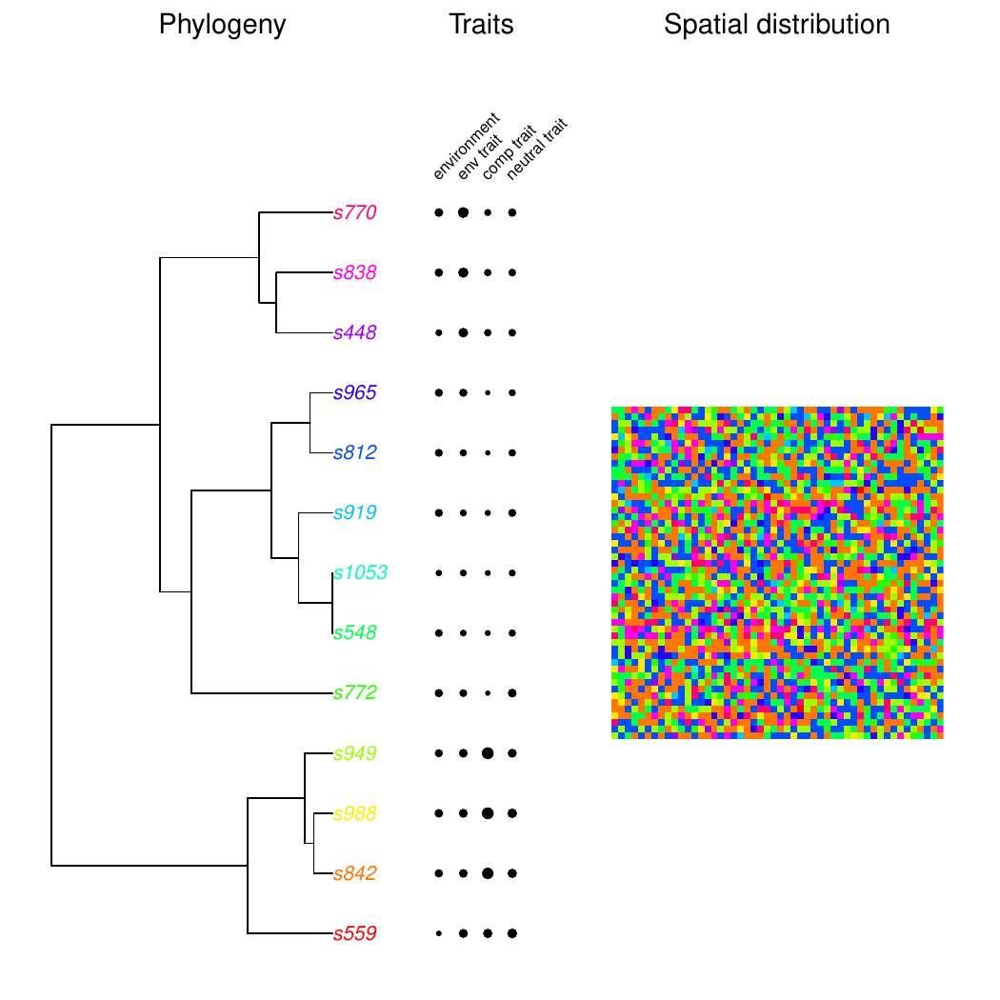
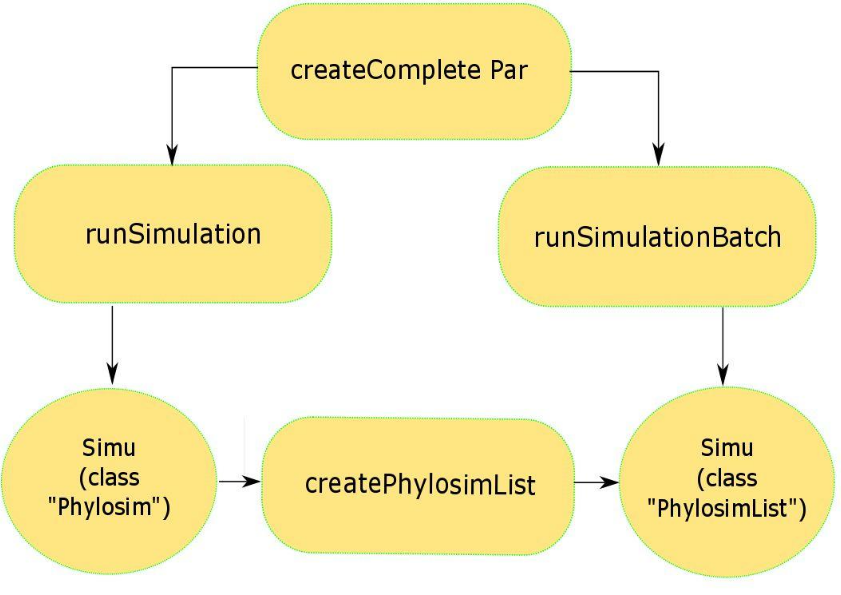
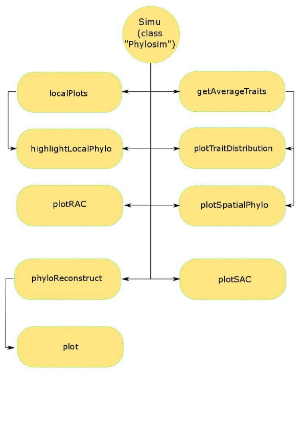

```{r setup, include = FALSE}
knitr::opts_chunk$set(
  collapse = TRUE,
  comment = "#>",
  fig.align = "center",
  fig.height = 4,
  fig.width = 4
)
```

```{r titlefig, echo = FALSE, out.width = "70%", fig.cap = "The basic output of the PhyloSim simulation: spatial distribution, phylogeny and traits in a biogeographic region."}

```

Tutorial for the PhyloSim package. Comments and contact:
Florian Hartig, Theoretical Ecology, University of Regensburg [website](https://www.uni-regensburg.de/biologie-vorklinische-medizin/forschen/arbeitsgruppen/ag-hartig).

**Warning for the user:** consider this package to be in a beta-stage.

**To obtain the package:** the package is not on CRAN yet. Follow the
instructions on <https://github.com/TheoreticalEcology/EcoPhyloSim> to install
the development version, e.g.

```{r install, eval = FALSE}
devtools::install_github(repo = "TheoreticalEcology/EcoPhyloSim",
                         subdir = "PhyloSim",
                         dependencies = TRUE,
                         build_vignettes = TRUE)

?PhyloSim
browseVignettes("PhyloSim")
```

**To cite the package:** use the citation information provided with the package.

```{r citation}
citation("PhyloSim")
```

This work is licensed under a Creative Commons
Attribution-NonCommercial-NoDerivatives 4.0 International License.

# Model description and running the model

## Overview

The PhyloSim package is a modeling environment for neutral and non-neutral biogeographic simulations. It generates a) spatial distribution and diversity metrics, b) phylogeny and c) traits from four basic processes: i) dispersal, ii) (adaptive) environmental preferences, iii) (adaptive) competitive traits, and iv) speciation in a stochastic simulation.

The package allows the user to choose between a number of options for each of these processes, and provides functions for analyzing the results, including standard biogeographic and phylogenetic summaries such as species-area curves, rank-abundance curves or phylogenetic balance and diversity.

## State variables

**The grid:** the simulation runs on a spatially discrete grid. Each cell is
occupied by one individual at any time. Additionally an environmental gradient
can be included. To avoid boundary effects the boundaries of the grid are
wrapped.

**Individuals:** each individual has three traits: an environmental trait, a
competition trait, and a neutral trait. The properties of these traits are
described in more detail in the section on ecological processes.

**Species and phylogeny:** each individual belongs to a species. Species
properties are described by the mean of the respective traits of all
individuals of the species. The species traits serve as an attractor in the
individual trait evolution process. Further, each species contains information
about its parent species and the species that emerged from it, which gives rise
to the overall phylogeny.

## Ecological processes

The simulation runs over a defined number of generations. In each generation,
individuals die and are replaced by offspring with slightly changed traits
(steps 1--3 below), and then new species arise (next section). The symbols
below refer to the arguments of `createCompletePar()` (see also the table in
the section Parameters).

**1. Mortality and replacement.** Cells are drawn at random (with replacement)
until $N = x \cdot y$ individuals have died, so some individuals die several
times per generation and others not at all. If fitness acts (`environment`,
`density`, `redQueen` or `redQueenStrength` > 0), a drawn individual $i$ dies
only if its fitness $w_i$ (step 3 below) is smaller than a uniform random
number $u \sim U(0, 1)$; otherwise it survives and the next cell is drawn.
Every $k$-th draw, with $k$ = `fitnessBaseMortalityRatio`, kills the drawn
individual regardless of its fitness. $k$ therefore controls the strength of
selection: with $k = 1$ all deaths are random and the model is neutral even if
`environment` or `density` are > 0. If fitness does not act, every draw kills,
which gives the neutral model.

The dead individual is replaced by the offspring of a parent. With global
dispersal, the parent is drawn uniformly from all other cells (the dead
individual is never its own parent,
[#81](https://github.com/TheoreticalEcology/EcoPhyloSim/issues/81)). With local dispersal, it is drawn from the cells within
the radius $R$ (excluding the cell itself), with weights

$$ w_d = \exp\left(-\frac{d}{\delta}\right), $$

where $d$ is the Euclidean distance, $R = \lfloor 2 \cdot \texttt{dispersal}
\rfloor$ and $\delta = R / 2$; only multiples of 0.5 of `dispersal` therefore
have an effect. The neighborhood is a discretized circle: all cells with
$|\Delta x| \le R$ and $|\Delta y| \le \lfloor\sqrt{R^2 - \Delta x^2}\rfloor$.

**2. Trait evolution.** The offspring inherits the species and the three traits
(environmental, competition and neutral trait) of its parent. Each trait then
changes by a small random step and is attracted towards the mean trait of its
species:

$$ \mathrm{newtrait} = (1 - w_s)\cdot p + w_s \cdot s + r, $$

where $p$ is the parent's trait value, $s$ is the mean trait value of the
species, $w_s = 0.2$ is a fixed attraction weight, and $r$ is drawn uniformly
from $[-0.01, 0.01]$. Values outside $[0, 1]$ are reflected at the boundary.

**3. Fitness.** The fitness of individual $i$ is the sum of an environmental
and a competition term, each included only if the corresponding parameter is
> 0:

$$ w_i = \underbrace{e \cdot \exp\left(-\frac{(E_i - t_i)^2}{2\sigma^2}\right) + 1 - e}_{\text{if } e > 0} \; + \; \underbrace{c \cdot D_i + 1 - c}_{\text{if } c > 0}, $$

where $e$ = `environment`, $E_i$ is the environment of the cell, $t_i$ is the
environmental trait of the individual, $\sigma = 0.0366$ is a fixed niche
width, and $c$ = `density`. $D_i$ is the mean absolute difference between the
competition trait $c_i$ of the individual and those of its neighbors within
the radius $R_D$ = `densityCut` (same discretized circle as for dispersal),

$$ D_i = \frac{\sum_{j \ne i} |c_i - c_j|}{n}, $$

where $n$ is the number of cells in the neighborhood, including the focal cell.
$D_i$ is updated whenever an individual in the neighborhood is replaced.

Some consequences of this formula:

- Each term is at least $1 - e$ or $1 - c$. If both terms are included, $w_i$
  can exceed 1; such individuals survive every draw except the
  fitness-independent ones (every $k$-th draw).
- All individuals start with the same traits (0.5), so $D_i = 0$ at the start
  and density dependence acts only after the competition traits have diverged.

**Environment.** If no `airmat` is given, the environment varies only along the
x-axis: it increases linearly in steps of $2/x$ from 0 in the first column to 1
in column $x/2 + 1$ and then decreases again, so for even $x$ all values except
the minimum and maximum occur in two bands; for odd $x$, the maximum is
$(x+1)/x$ ([#142](https://github.com/TheoreticalEcology/EcoPhyloSim/issues/142)). A
user-defined environment can be passed as a matrix with values in $[0, 1]$
(`airmat`).

## Speciation mechanisms

The default speciation mechanism is point speciation: in each generation, the
number of new species is drawn from a Poisson distribution with mean
`specRate`, and for each of them an individual is chosen at random. `specRate`
is thus the expected number of new species per generation in the whole grid,
not a rate per individual. The founding individual keeps its traits, which
become the initial trait means of the new species (no trait change at
speciation, see
[#114](https://github.com/TheoreticalEcology/EcoPhyloSim/issues/114)).

All speciation mechanisms implemented in the model are summarized below:

- **Point Mutation:** the default, see above.
- **Fission Type 1:** a species is randomly chosen and every second individual
  of the species becomes part of a new species.
- **Fission Type 2:** a species is randomly chosen and geographically split in
  two parts. One part evolves to a new species, the other part is not affected.
- **Protracted Speciation:** based on @rosindell2010, a species undergoes an
  'incipient' stage before becoming a new species. In the implementation, the
  chosen individual becomes a new species only if it survives `protracted`
  generations; its offspring do not inherit the incipient state. `specRate` is
  then the expected number of incipient individuals per generation.
- **Red Queen:** based on @odwyer2014, new species have advantages over old
  species due to their novelty alone, and the effect vanishes over time. The
  fitness is multiplied by $1 + s \exp(-q\,a)$, where $s$ = `redQueenStrength`,
  $q$ = `redQueen` and $a$ is the number of generations since the species arose,
  minus one; without environment and density dependence, the base fitness is
  set to 0.01.

## Parameters

`createCompletePar()` and `runSimulation()` check all ranges in the table,
except that only multiples of 0.5 of `dispersal` have an effect (see
`?createCompletePar`).

| Argument | Meaning | Range |
|---|---|---|
| `x`, `y` | grid dimensions (cells); the grid is a torus | integers $\ge 1$, $x \cdot y \ge 2$ |
| `dispersal` | `"global"` (or 0), or the dispersal distance (see step 1) | `"global"`, 0 or $\ge 0.5$ with $2 \cdot$ `dispersal` $\le \min(x, y)$; steps of 0.5 |
| `specRate` | expected number of new species per generation in the whole grid | $\ge 0$ |
| `environment` | weight $e$ of the environmental fitness term | $[0, 1]$ |
| `density` | weight $c$ of the competition fitness term | $[0, 1]$ |
| `densityCut` | radius $R_D$ of the competition neighborhood | integer $\ge 1$, $\le \min(x, y)$ |
| `fitnessBaseMortalityRatio` | every $k$-th draw kills regardless of fitness | integer $\ge 1$; 1 gives a neutral model |
| `fission` | speciation by fission: 0 (none), 1 or 2 | 0, 1, 2 |
| `protracted` | generations an incipient species must survive | integer $\ge 0$ |
| `redQueenStrength`, `redQueen` | strength $s$ and decay $q$ of the novelty advantage | $\ge 0$ |
| `fitnessActsOn` | whether fitness acts on mortality (described here), reproduction or both | `"mortality"` (default), `"reproduction"`, `"both"`; see `?createCompletePar` |

## Running the model in R

The first thing to do is, obviously, loading the package:

```{r library, message = FALSE}
library(PhyloSim)
```

Running the model consists of two consecutive steps. First, a list of parameters
is generated based on the user's settings.

```{r createpar}
par <- createCompletePar(x = 50, y = 50, dispersal = "global", runs = c(500, 1000),
                         density = 1, environment = 0.5, specRate = 1, type = "base")
```

In this example, an area of 50*50 cells provides the basis for one simulation
with outputs recorded after 500 and 1000 generations. The dispersal is set to
global, meaning each individual could reproduce in every cell of the grid.
Further, the density as well as the environment have an influence on the
individuals. For further explanations and more settings see:

```{r createpar-help, eval = FALSE}
?createCompletePar
```

The list of parameters is now used to execute the simulation:

```{r runsim, results = 'hide'}
simu <- runSimulation(par)
```

The output is saved as an object of type `PhyloSim`. Each `PhyloSim` object
contains two lists, `$Output` and `$Model`. All model results are saved in the
`Output` list.

In this example, the output consists of two results, the simulation after 500
and 1000 generations. They contain the spatial species matrix, the
(environmental) trait matrix, the environmental matrix (representing the
environment), the competition matrix and the neutral matrix, as well as the
phylogeny in two formats.

To access them, the easiest way is to use indices:

```{r output1}
Output1 <- simu$Output[[1]]
str(Output1)
```

The simulation settings are saved in the model object:

```{r model}
str(simu$Model)
```

The `PhyloSim` object serves as the basis of all further analysis. It can
directly be passed to all other functions. If the `PhyloSim` object contains
multiple results, they can be accessed by the `which.result` argument in most
functions. By default, the last result is used.

Often, users will want to run several simulations with different or equal
parameters. For this purpose, the `runSimulationBatch` function allows running a
list of parameter combinations. The function can make use of parallel computing
and returns an object of class `PhylosimList`, which is essentially a list of
`PhyloSim` objects. In the following example, two slightly different parameter
sets are created and processed one after the other. For larger batches,
`parallel = 2` runs them on two cores.

```{r runbatch, results = 'hide'}
par1 <- createCompletePar(x = 50, y = 50, dispersal = "global", runs = 1000,
                          density = 1, environment = 0.5, specRate = 1, type = "base")

par2 <- createCompletePar(x = 50, y = 50, dispersal = "global", runs = 1000,
                          density = 1, environment = 1, specRate = 1, type = "base")

parmBatch <- list(par1, par2)

simuBatch <- runSimulationBatch(parmBatch, parallel = FALSE)
```

The `simuBatch` object contains two `PhyloSim` objects saved in a list. You can
easily access them separately by indexing. For example:

```{r batch-index}
simu1 <- simuBatch[[1]]
```

An overview of the basic classes and functions to run simulations is provided
below.

```{r runfig, echo = FALSE, out.width = "80%", fig.cap = "Overview of the basic model functions in the PhyloSim package. Functions are represented by bubbles, objects by circles. Objects of the class PhylosimList can be indexed if a single PhyloSim object is needed."}

```

# Plots and summary statistics

After the description of the simulation environment in the previous chapter, the
present one explains plots and summary statistics that can be created from the
`PhyloSim` and `PhylosimList` objects.

## Plot functions

The PhyloSim package contains multiple functions to visualize the results of the
simulation, which are summarized in the overview figure at the end of this
chapter.

**`plotSpatialPhylo`:** the easiest way to get an overview of the results of one
simulation is the `plotSpatialPhylo` function, which is also the default plot
function for a `PhyloSim` object.

```{r plotspatialphylo, fig.width = 7, fig.height = 5, fig.cap = "The plotSpatialPhylo plot consists of three different figures: a phylogeny that shows the evolutionary history of the species, a trait plot that shows the trait values for each of the species (coded by size), and the spatial distribution of individuals, with colors matching the colors in the phylogeny. Which of these figures are plotted can be triggered with the arguments plot and plotTraits (see help)."}
plotSpatialPhylo(simu, plot = "both", plotTraits = TRUE, which.result = NULL)
```

**Species-area curve (SAC):** the SAC shows the accumulated species richness as
a function of area. It is calculated by creating plots of different sizes in the
meta-community.

```{r sac, results = 'hide', fig.width = 5, fig.height = 5, fig.cap = "Species richness as a function of the plot size of a local community. A positively bent curve indicates clustering of a species community. A negatively bent curve indicates a more neutral distribution of species within the community."}
sac(simu, which.result = NULL)
```

**Rank-abundance curve (RAC):** the rank-abundance curve shows the abundance of
each species within the meta-community.

```{r rac, results = 'hide', fig.width = 5, fig.height = 5, fig.cap = "Rank-abundance curve (RAC). Each species is given a rank according to its abundance (highest abundance = rank 1), then abundance is plotted against rank. A linear curve indicates a less stable or neutral community supporting only a few highly abundant species, whereas an S-shaped curve indicates a more stable community."}
rac(simu, which.result = NULL)
```

**Trait plots:** for a closer look at the traits you can visualize them using
the `plotTraitDistribution` function.

```{r traitdist, fig.width = 7, fig.height = 6, fig.cap = "The plotTraitDistribution plot consists of three figures for the three traits in the model (environmental trait, competition trait, neutral trait). The upper panel illustrates the trait magnitude as a function of the environment for different species, the middle panel the spatial distribution of the given trait, and the lower panel a histogram of the given trait."}
plotTraitDistribution(simu = simu, which.result = NULL, type = "all")
```

**Reconstructed phylogenies:** the function `phyloReconstruct` uses the species'
traits to construct a phylogeny for the given community. These phylogenies can
then be compared to the real phylogeny of the community.

```{r phylorecon, fig.width = 7, fig.height = 4, fig.cap = "Reconstructed phylogeny (left) and real phylogeny (right). There are differences in the species that make up the resulting communities as well as in their assembly."}
Phyl   <- ape::drop.fossil(simu$Output[[2]]$phylogeny)
rePhyl <- phyloReconstruct(simu)

par(mfrow = c(1, 2))
plot(rePhyl, main = "reconstructed Phylogeny")
plot(Phyl, main = "real Phylogeny")
```

**Highlight local communities:** the function `highlightLocalPhylo` highlights
the phylogeny of a local community within a metacommunity.

```{r highlight-large, fig.width = 6, fig.height = 5.4, fig.cap = "Highlights a relatively large local community."}
highlightLocalPhylo(simu, size = 10, n = 1)
```

```{r highlight-small, fig.width = 6, fig.height = 5.4, fig.cap = "Highlights a relatively small local community."}
highlightLocalPhylo(simu, size = 5, n = 1)
```

Both figures show the phylogeny of the same metacommunity but highlight different
local plots with different plot sizes (10 and 5). The larger plot is richer in
species than the smaller one.

```{r plotsfig, echo = FALSE, out.width = "70%", fig.cap = "Overview of the plotting functions in the PhyloSim package. Functions are represented by bubbles, objects by circles. The arrows illustrate what is used as input parameter for the functions."}

```

## Summary statistics

Quite a few of the functions, such as species-area curves and local
phylogenies, are based on the `localPlots` function, a simple observation model
that creates random subplots of a given size within the metacommunity.

```{r localplots}
localPlots(simu, size = 10, n = 2)
```

## Null models

To compare patterns in the results of the simulations with random expectations,
the package comprises a set of null models. The null model creates subplots from
the metacommunity and tests them against random expectations.

**The `nullModel` function:**

```{r nullmodel, eval = FALSE}
pValues <- nullModel(simu = simu, abundance = FALSE, localPlotSize = 10,
                     numberOfPlots = 20, repetitions = 100, fun = "mpd")
```

**The `calculatePhylogeneticDispersion` function:** this and its associated plot
functions are convenience functions for a rather specialized application -- the
function calculates null models for all runs in a `PhylosimList` object and for
different plot sizes. Which null model is used is determined by the `type`
argument with the following options:

- `"PhylMeta"`: equivalent to the `nullModel` function with `abundance = FALSE`.
- `"PhylSample"`: equivalent to the `nullModel` function with `abundance = TRUE`.
- `"PhylPool"`: uses `picante::ses.mpd` with `null.model = "phylogeny.pool"`.
- `"SamplePool"`: uses `picante::ses.mpd` with `null.model = "sample.pool"`.

```{r calcphyldis, eval = FALSE}
pValuesBatch <- calculatePhylogeneticDispersion(simuBatch, plotlengths = 3,
                                                plots = 20, replicates = 20,
                                                type = "PhylMeta")
```

The result can be visualized with the `plotPhylogeneticDispersion` function:

```{r plotphyldis, fig.width = 6, fig.height = 5, fig.cap = "Different combinations of dispersal limitation (y-axis), environmental trait (upper x-axis) and density dependence (lower x-axis). The color shows the phylogenetic pattern (over- or underdispersed)."}
data("pPD.pvalues")
data("pPD.positions")

plotPhylogeneticDispersion(pvalues = pPD.pvalues, positions = pPD.positions,
                           title = "Null Meta")
```

# Emerging patterns

This chapter shows how the main outputs of the model respond to its
parameters, and compares them with what theory and earlier studies lead us to
expect. For the neutral model, some expectations are exact analytical
results; for the other processes, the literature mostly predicts the direction
of an effect. The parameters are varied one at a time around a reference
setting (50 × 50 cells, `dispersal = 1`, `specRate = 2`, all other parameters
at their defaults), with replicate runs per setting. The simulations take
hours to days, so they are not run when this vignette is built: they were run
with the script `data-raw/packageBehavior.R` in the
[package repository](https://github.com/TheoreticalEcology/EcoPhyloSim), and
their summaries are stored in the data set `packageBehavior` (see
`?packageBehavior`).

The indicators are computed for the whole grid at each census: species
richness, Shannon diversity, the share of the four neighbors of a cell that
belong to the same species (spatial aggregation), the correlation between the
environmental trait and the environment, the standard deviation of the
competition trait, and the Yule-normalized Colless index and the gamma
statistic of the tree of the extant species. The table summarizes the
expectations that the following sections test.

| Process | Expectation | Source |
|---|---|---|
| Neutral model, global dispersal | richness and abundance distribution as in the Ewens sampling formula with $\theta \approx$ `specRate`; share of conspecific neighbors $1/(1+\theta)$ | @ewens1972, @vallade2003 |
| Neutral model | tree more imbalanced than a Yule tree (Colless index > 0); species old, abundant species older | @davies2011, @manceau2015, @chisholm2014 |
| Neutral model | mortality independent of the number of conspecific neighbors | by definition |
| Dispersal limitation | spatial clusters of conspecifics; similarity decreasing with distance; steeper species–area curves within the grid | @durrett1996, @rosindell2007, @chave2002, @chaveleigh2002 |
| Environmental filtering | traits match the environment, more so with local dispersal; effect on richness can be positive or negative | @mouquet2003, @stein2014, @allouche2012 |
| Density dependence | more species, more even abundances, fewer conspecific neighbors, more dispersed competition traits; mortality increases with the number of conspecific neighbors | @chave2002, @levi2019, @scheffer2006, @comita2010 |
| Protracted speciation | fewer species | @rosindell2010, see below |
| Red Queen | younger species | @odwyer2014 |

```{css, echo = FALSE}
.expectation {
  background-color: #f2f6fa;
  border-left: 4px solid #0072B2;
  padding: 0.4em 1em;
  margin: 1em 0;
}
```

```{r patterns-setup, echo = FALSE}
data("packageBehavior")
pilot <- packageBehavior$pilot
main <- packageBehavior$main

labels <- c(richness = "Species richness", shannon = "Shannon diversity",
            conspecificNeighbors = "Conspecific neighbors",
            corTraitEnv = "Cor(trait, env.)",
            sdCompetitionTrait = "SD comp. trait",
            colless = "Colless index", gamma = "Gamma statistic")
# colorblind-safe palette (Okabe & Ito)
cols <- c("#0072B2", "#D55E00", "#009E73", "#CC79A7", "#E69F00", "#56B4E9")

# common style of all figures in this chapter (set for each chunk by the hook)
style <- function(...) par(mar = c(3.4, 3.4, 1.6, 0.6), mgp = c(2.1, 0.55, 0), tcl = -0.3,
                           las = 1, bty = "l", cex = 0.75, font.main = 1, cex.main = 1, ...)
knitr::knit_hooks$set(style = function(before, options, envir) if (before) style())
knitr::opts_chunk$set(style = TRUE, fig.retina = 2)

# x axis with plain numbers (no scientific notation) on a log scale
logAxis <- function(side = 1) {
  at <- axTicks(side)
  axis(side, at = at, labels = format(at, big.mark = ",", scientific = FALSE, trim = TRUE))
}

# legend in an empty panel of a multi-panel figure
legendPanel <- function(...) {
  plot.new()
  legend("center", bty = "n", cex = 0.95, ...)
}

# 95% confidence intervals as error bars (skips intervals of width 0)
ciBars <- function(x, m, ci, col) {
  ok <- is.finite(ci) & ci > 0
  arrows(x[ok], m[ok] - ci[ok], x[ok], m[ok] + ci[ok], angle = 90, code = 3,
         length = 0.02, col = col)
}

# setting number of a block with the given parameter values
settingId <- function(d, block, ...) {
  s <- d$settings[d$settings$block == block, ]
  v <- list(...)
  for (n in names(v)) s <- s[s[[n]] == v[[n]], ]
  s$setting
}

# replicate mean and 95% confidence interval at the last census of each setting
final <- function(d, block, indicator) {
  x <- d$census[d$census$block == block & d$census$indicator == indicator, ]
  x <- x[x$generation == ave(x$generation, x$setting, FUN = max), ]
  x$ci <- qt(0.975, pmax(x$n - 1, 1)) * x$sd / sqrt(x$n)
  merge(d$settings[d$settings$block == block, ], x[c("setting", "mean", "ci", "n")])
}

# indicators against a parameter (x-axis), one line per value of `group`
response <- function(d, block, xvar, group = NULL, indicators = names(labels),
                     xlab = xvar, log = "", settings = NULL) {
  op <- style(mfrow = c(2, ceiling((length(indicators) + 1) / 2)))
  on.exit(par(op))
  for (ind in indicators) {
    f <- final(d, block, ind)
    if (!is.null(settings)) f <- f[f$setting %in% settings, ]
    f <- f[order(f$setting), ]
    xv <- f[[xvar]]
    isFactor <- is.character(xv)
    if (isFactor) xv <- match(xv, unique(xv))
    g <- if (is.null(group)) rep("", nrow(f)) else as.character(f[[group]])
    yr <- range(c(f$mean - f$ci, f$mean + f$ci), na.rm = TRUE)
    if (!all(is.finite(yr))) yr <- c(0, 1)
    plot(xv, f$mean, type = "n", ylim = yr, xlab = xlab, ylab = "", main = labels[ind],
         log = log, xaxt = "n")
    if (isFactor) axis(1, at = seq_along(unique(f[[xvar]])), labels = unique(f[[xvar]]), gap.axis = 0)
    else if (grepl("x", log)) logAxis(1) else axis(1)
    for (k in seq_along(unique(g))) {
      sel <- g == unique(g)[k]
      lines(xv[sel], f$mean[sel], col = cols[k], type = "b", pch = 16)
      ciBars(xv[sel], f$mean[sel], f$ci[sel], cols[k])
    }
  }
  if (!is.null(group))
    legendPanel(legend = unique(g), col = cols[seq_along(unique(g))], lty = 1, pch = 16,
                title = group)
}

# replicate mean (line) and mean +/- sd (band) of each indicator over time
trajectories <- function(d, cases, indicators = names(labels)) {
  op <- style(mfrow = c(2, ceiling((length(indicators) + 1) / 2)))
  on.exit(par(op))
  for (ind in indicators) {
    x <- d$census[d$census$indicator == ind, ]
    sub <- lapply(seq_len(nrow(cases)), function(k)
      x[x$block == cases$block[k] & x$setting == cases$setting[k], ])
    yr <- range(unlist(lapply(sub, function(s) c(s$mean - s$sd, s$mean + s$sd))), na.rm = TRUE)
    plot(1, type = "n", log = "x", xlim = range(x$generation), ylim = yr,
         xlab = "Generation", ylab = "", main = labels[ind], xaxt = "n")
    logAxis(1)
    for (k in seq_along(sub)) {
      s <- sub[[k]][order(sub[[k]]$generation), ]
      ok <- is.finite(s$sd)
      polygon(c(s$generation[ok], rev(s$generation[ok])),
              c(s$mean[ok] - s$sd[ok], rev(s$mean[ok] + s$sd[ok])),
              col = adjustcolor(cols[k], 0.25), border = NA)
      lines(s$generation, s$mean, col = cols[k])
    }
  }
  legendPanel(legend = cases$label, col = cols[seq_len(nrow(cases))], lwd = 2)
}

# neutral theory for J individuals and specRate new species per generation:
# speciation probability per replacement nu = specRate / J and
# theta = (J - 1) nu / (1 - nu) (Vallade & Houchmandzadeh 2003, eq. 6)
theta <- function(specRate, J) (J - 1) * (specRate / J) / (1 - specRate / J)
# expected species richness (Ewens sampling formula)
ewens <- function(theta, J) sum(theta / (theta + 0:(J - 1)))
# expected rank-abundance curve: mean of sorted abundances of random
# Ewens partitions (Hoppe urn); like the simulated curves, each rank is
# averaged over the partitions that have at least that many species
ewensRac <- function(theta, J, reps = 200) {
  racs <- replicate(reps, {
    sp <- integer(J)
    n <- 0
    for (i in seq_len(J)) {
      if (runif(1) < theta / (theta + i - 1)) {
        n <- n + 1
        sp[i] <- n
      } else sp[i] <- sp[sample.int(i - 1, 1)]
    }
    sort(tabulate(sp), decreasing = TRUE)
  }, simplify = FALSE)
  len <- max(lengths(racs))
  rowMeans(sapply(racs, function(r) c(r, rep(NA, len - length(r)))), na.rm = TRUE)
}
```

## Time to equilibrium

All results below refer to the state of the model at the end of the runs,
which should be in equilibrium. In the neutral model, abundances change only by
drift, which is slower in larger communities. We therefore expect the time to
equilibrium to grow with the number of cells, and to be longer for indicators
that depend on
the whole history of the community (the phylogeny) than for those that depend
on the current abundances.

To check how long the model needs to reach equilibrium, a pilot run simulated
each setting for
`r format(packageBehavior$info$modes$pilot$generations[["default"]], big.mark = ",")`
generations
(`r format(packageBehavior$info$modes$pilot$generations[["density"]], big.mark = ",")`
for density dependence) with
`r packageBehavior$info$modes$pilot$reps` replicates. The figure shows the
replicate mean (line) and the variation between replicates (band: mean ± sd)
of each indicator over time for five settings.

```{r equilibrium, echo = FALSE, fig.width = 7, fig.height = 5, fig.cap = "Indicators over time in the pilot runs: replicate mean (line) and mean ± standard deviation across replicates (band)."}
cases <- data.frame(
  block = c("neutral", "neutral", "dispersal", "environment", "density"),
  setting = c(settingId(pilot, "neutral", specRate = 2, x = 50),
              settingId(pilot, "neutral", specRate = 0.5, x = 100),
              settingId(pilot, "dispersal", dispersal = "1"),
              settingId(pilot, "environment", environment = 1, dispersal = "1"),
              settingId(pilot, "density", density = 1, densityCut = 1)),
  label = c("neutral, global", "neutral, global,\n100 x 100,\nspecRate 0.5",
            "neutral, dispersal 1", "environment 1", "density 1"))
trajectories(pilot, cases)
```

The table gives, for the same settings, the first census after which the
replicate mean of an indicator stays within 5% of its final level (the mean
over the last quarter of the run) or within its 95% confidence interval,
whichever is wider.

```{r equilibrium-table, echo = FALSE}
eqTime <- function(d, block, setting, indicator) {
  x <- d$census[d$census$block == block & d$census$setting == setting &
                  d$census$indicator == indicator, ]
  x <- x[order(x$generation), ]
  last <- x$generation >= 0.75 * max(x$generation)
  level <- mean(x$mean[last])
  tol <- max(0.05 * abs(level), mean(qt(0.975, x$n[last] - 1) * x$sd[last] / sqrt(x$n[last])))
  out <- which(is.na(x$mean) | abs(x$mean - level) > tol)
  if (length(out) == 0) return(format(min(x$generation), big.mark = ","))
  if (max(out) == nrow(x)) return("not reached")
  format(x$generation[max(out) + 1], big.mark = ",")
}
tab <- sapply(seq_len(nrow(cases)), function(k)
  sapply(names(labels), eqTime, d = pilot, block = cases$block[k], setting = cases$setting[k]))
dimnames(tab) <- list(labels, cases$label)
knitr::kable(tab, caption = "Generations to equilibrium in the pilot runs.")
```

## Neutral model and speciation rate

::: {.expectation}
**Expectation.** With global dispersal and no fitness differences, the model
is a zero-sum Moran model: in each generation, $J = x \cdot y$ individuals die
and are replaced by offspring of random individuals, and on average `specRate`
of the replacements found a new species, so the speciation probability per
replacement is $\nu = \texttt{specRate}/J$. (In `runSimulation()`, the new
species arise at the end of each generation rather than at single
replacements, so the model is close to, but not exactly, a Moran model.) The
equilibrium of the Moran model is known exactly [@vallade2003]. The number of
species follows the Ewens sampling formula [@ewens1972],
$$E(S) = \sum_{i=0}^{J-1} \frac{\theta}{\theta + i}, \qquad
\theta = \frac{(J-1)\,\nu}{1-\nu} \approx \texttt{specRate}.$$
For large $J$ and small $\nu$, this $\theta$ is about half of the fundamental
biodiversity number $2J\nu$ used in other formulations of neutral theory
[@vallade2003]; `es()` uses $2J\nu$
(see [#124](https://github.com/TheoreticalEcology/EcoPhyloSim/issues/124)). The
same theory predicts that two random individuals belong to the same species
with probability $1/(1+\theta)$. With global dispersal, space plays no role, so
this is also the expected share of conspecific neighbors. The theory also gives
the expected abundance distribution [@vallade2003], which we compare with the
rank-abundance curve of the model.

For the tree of the extant species, neutral theory predicts more imbalance
than a Yule tree, because the speciation probability of a species is
proportional to its abundance [@davies2011; @manceau2015]. The
Yule-normalized Colless index is close to 0 for Yule trees [@blum2006], so we
expect positive values. Neutral models in equilibrium are not expected to show
the slowdown of branching towards the present (negative gamma statistic) that
is typical of empirical trees [@davies2011; @manceau2015; @phillimore2008].
:::

```{r neutral, echo = FALSE, fig.width = 7, fig.height = 3.5, fig.cap = "Neutral model with global dispersal against the speciation rate, for three grid sizes (replicate mean and 95% confidence interval). Left: species richness; dashed: Ewens sampling formula, dotted: es(). Right: share of conspecific neighbors; dashed: 1/(1 + theta)."}
op <- par(mfrow = c(1, 2))
f <- final(main, "neutral", "richness")
g <- final(main, "neutral", "conspecificNeighbors")
sizes <- sort(unique(f$x))
sr <- exp(seq(log(min(f$specRate)), log(max(f$specRate)), length.out = 30))
plot(f$specRate, f$mean, type = "n", log = "xy", xlab = "specRate",
     ylab = "Species richness", ylim = range(c(pmax(f$mean - f$ci, 1), 2 * f$mean), na.rm = TRUE))
for (k in seq_along(sizes)) {
  s <- f[f$x == sizes[k], ]
  points(s$specRate, s$mean, col = cols[k], pch = 16)
  ciBars(s$specRate, s$mean, s$ci, cols[k])
  lines(sr, sapply(sr, function(r) ewens(theta(r, sizes[k]^2), sizes[k]^2)), col = cols[k], lty = 2)
  lines(sr, sapply(sr, es, dimensions = sizes[k]), col = cols[k], lty = 3)
}
legend("topleft", legend = paste(sizes, "x", sizes), col = cols[seq_along(sizes)],
       pch = 16, bty = "n")
plot(g$specRate, g$mean, type = "n", log = "x", xlab = "specRate",
     ylab = "Conspecific neighbors", ylim = c(0, 1))
for (k in seq_along(sizes)) {
  s <- g[g$x == sizes[k], ]
  points(s$specRate, s$mean, col = cols[k], pch = 16)
  ciBars(s$specRate, s$mean, s$ci, cols[k])
  lines(sr, 1 / (1 + theta(sr, sizes[k]^2)), col = cols[k], lty = 2)
}
par(op)
```

```{r neutral-rac, echo = FALSE, fig.width = 4.5, fig.height = 4, fig.cap = "Rank-abundance curve of the neutral model with global dispersal (50 x 50 cells, specRate = 2; replicate mean) and the expectation from the Ewens sampling formula (dashed)."}
s <- settingId(main, "neutral", specRate = 2, x = 50)
r <- main$rac[main$rac$block == "neutral" & main$rac$setting == s, ]
r <- r[order(r$rank), ]
set.seed(1)
e <- ewensRac(theta(2, 2500), 2500)
plot(r$rank, r$mean, log = "y", pch = 16, col = cols[1], xlab = "Rank",
     ylab = "Abundance", xlim = range(c(r$rank, seq_along(e))), ylim = c(0.5, max(r$mean, e)))
lines(seq_along(e)[e >= 0.5], e[e >= 0.5], lty = 2)
```

## Dispersal

::: {.expectation}
**Expectation.** With local dispersal, offspring settle near their parents, so
conspecifics form spatial clusters [@chaveleigh2002] and the share of
conspecific neighbors increases. Lineages in different parts of the grid stay
apart longer before they replace each other, so we expect more species on the
whole grid than with global dispersal. Species–area curves within a landscape
are steep at small areas when dispersal is short relative to the area
[@durrett1996; @rosindell2007], whereas global dispersal gives flatter curves
[@chave2002].
:::

```{r dispersal, echo = FALSE, fig.width = 7, fig.height = 5, fig.cap = "Indicators against dispersal (replicate mean and 95% confidence interval)."}
response(main, "dispersal", "dispersal")
```

```{r dispersal-sac, echo = FALSE, fig.width = 4.5, fig.height = 4, fig.cap = "Species-area curves within the grid (mean number of species in square subplots of the given area) for different dispersal distances."}
s <- main$sac[main$sac$block == "dispersal", ]
st <- main$settings[main$settings$block == "dispersal", ]
plot(s$size, s$mean, type = "n", log = "xy", xlab = "Subplot area (cells)",
     ylab = "Species")
for (k in seq_len(nrow(st))) {
  x <- s[s$setting == st$setting[k], ]
  x <- x[order(x$size), ]
  lines(x$size, x$mean, col = cols[k], type = "b", pch = 16)
}
legend("topleft", legend = st$dispersal, col = cols[seq_len(nrow(st))], lty = 1,
       pch = 16, title = "dispersal", bty = "n")
```

The probability that two individuals at a given distance belong to the same
species is expected to decrease with distance when dispersal is limited
[@chaveleigh2002; @condit2002]. With global dispersal, it should be the same at
all distances and equal to the neutral expectation $1/(1+\theta)$.

```{r dispersal-decay, echo = FALSE, fig.width = 4.5, fig.height = 4, fig.cap = "Probability that two cells at the given distance (along rows and columns) contain the same species, for different dispersal distances (replicate mean and 95% confidence interval). Dashed: neutral expectation for global dispersal."}
s <- main$decay[main$decay$block == "dispersal", ]
s$ci <- qt(0.975, pmax(s$n - 1, 1)) * s$sd / sqrt(s$n)
plot(s$distance, s$mean, type = "n", log = "x", ylim = c(0, 1),
     xlab = "Distance (cells)", ylab = "Same species")
for (k in seq_len(nrow(st))) {
  x <- s[s$setting == st$setting[k], ]
  x <- x[order(x$distance), ]
  lines(x$distance, x$mean, col = cols[k], type = "b", pch = 16)
  ciBars(x$distance, x$mean, x$ci, cols[k])
}
abline(h = 1 / (1 + theta(2, 2500)), lty = 2)
legend("topright", legend = st$dispersal, col = cols[seq_len(nrow(st))], lty = 1,
       pch = 16, title = "dispersal", bty = "n")
```

## Environmental filtering

::: {.expectation}
**Expectation.** Environmental filtering sorts species along the gradient, so
the correlation between trait and environment should increase with
`environment`. With local dispersal, offspring stay in the habitat of their
parents (species sorting); with global dispersal, many offspring land in
unsuitable cells (mass effects), which weakens the match between traits and
environment and reduces the differences between parts of the grid
[@mouquet2003]. The effect on richness can go either way: environmental
heterogeneity increases richness through niche partitioning in most empirical
studies [@stein2014], but in an area of fixed size, narrow niches reduce the
area available to each species and can reduce richness [@allouche2012]. With
the default niche width, a species finds good conditions only in a narrow band
of the gradient. Daughter species keep the traits of their founder, so closely
related species occupy similar positions on the gradient; such niche
conservatism together with environmental filtering is expected to make local
communities phylogenetically clustered [@webb2002]. For tree shape, we found
no consistent prediction.
:::

```{r environment, echo = FALSE, fig.width = 7, fig.height = 5, fig.cap = "Indicators against the strength of environmental filtering, for global and local dispersal."}
response(main, "environment", "environment", group = "dispersal")
```

## Strength of selection

::: {.expectation}
**Expectation.** With `fitnessBaseMortalityRatio = 1`, every death is random
and the model is neutral whatever the fitness; larger values make more deaths
depend on fitness. We therefore expect the effects of environmental filtering
and density dependence to increase with `fitnessBaseMortalityRatio`, starting
from the neutral values.
:::

```{r selection, echo = FALSE, fig.width = 7, fig.height = 5, fig.cap = "Indicators against fitnessBaseMortalityRatio, with environmental filtering (environment = 1) or density dependence (density = 1)."}
response(main, "selection", "fitnessBaseMortalityRatio", group = "environment", log = "x")
```

## Density dependence

::: {.expectation}
**Expectation.** In the model, an individual is fitter the more its
competition trait differs from those of its neighbors. Because the traits
within a species are similar, this acts like conspecific negative density
dependence, as in the Janzen-Connell hypothesis. Such density dependence is
expected to increase species richness and to make abundances more even
[@chave2002; @levi2019], more so for larger neighborhoods [@levi2019]; its
effect depends on how far offspring disperse relative to the neighborhood
[@adler2005]. It should reduce the share of conspecific neighbors. Competition
on a trait favors dissimilar trait values, so the spread of the competition
trait should increase; species may form groups of similar trait values rather
than spreading evenly along the trait axis [@scheffer2006].
:::

```{r density, echo = FALSE, fig.width = 7, fig.height = 5, fig.cap = "Indicators against the strength of density dependence, for two neighborhood radii (densityCut)."}
response(main, "density", "density", group = "densityCut")
```

## Environment and density dependence combined

::: {.expectation}
**Expectation.** Environmental filtering favors similar species in the same
place, and density dependence favors dissimilar neighbors, so the two
processes can mask each other in the patterns [@kraft2015]. Because the two
fitness terms are added, the model is neutral if both are > 0 and
`environment + density` ≤ 1 (see the description of mortality above and
[#144](https://github.com/TheoreticalEcology/EcoPhyloSim/issues/144)).
:::

```{r envdensity, echo = FALSE, fig.width = 7, fig.height = 5, fig.cap = "Indicators against environment, for three strengths of density dependence."}
response(main, "envDensity", "environment", group = "density")
```

## Speciation mechanisms

::: {.expectation}
**Expectation.** In the model, protracted speciation completes only if the
founding individual survives `protracted` generations (see above and
[#143](https://github.com/TheoreticalEcology/EcoPhyloSim/issues/143)). An
individual survives a generation with probability of about $e^{-1}$, so in the
neutral model protracted speciation should act like a speciation rate reduced
by a factor of about $e^{-p}$, and richness should decrease accordingly. In
the original model of protracted speciation, in which the whole incipient
lineage becomes a new species [@rosindell2010], the effects are different;
there, protracted speciation also slows down branching towards the present
[@etienne2012]. A Red Queen advantage of young species is expected to make
species younger without changing abundance distributions much
[@odwyer2014]. Without environment and density dependence, the base fitness is
0.01, so `redQueenStrength` must be large (here 100) for young species to
survive the fitness-dependent draws noticeably more often.
:::

```{r protracted, echo = FALSE, fig.width = 7, fig.height = 5, fig.cap = "Indicators against the duration of protracted speciation."}
response(main, "speciation", "protracted",
         settings = settingId(main, "speciation", redQueen = 0))
```

## Species ages

The age of a species is estimated from its ID: species are numbered in the
order of their origin, and new species arise at a roughly constant rate, so the
age of species $k$ at generation $G$ is about $G(1 - k/k_{max})$, where
$k_{max}$ is the largest ID in the phylogeny.

::: {.expectation}
**Expectation.** In neutral models, species persist for a long time, longer
than observed in nature [@chisholm2014], and since species start with one
individual and grow by drift, abundant species are on average older. A Red
Queen advantage of young species should make species younger
[@odwyer2014].
:::

```{r ages, echo = FALSE, fig.width = 7, fig.height = 3.5, fig.cap = "Mean species age (left) and rank correlation between age and abundance (right). Circles: neutral model with global dispersal against the speciation rate (50 x 50 cells). At specRate = 2, for dispersal = 1: without (square) and with a Red Queen advantage (triangles)."}
op <- par(mfrow = c(1, 2))
for (ind in c("meanSpeciesAge", "corAgeAbundance")) {
  f <- final(main, "neutral", ind)
  f <- f[f$x == 50, ]
  sp <- final(main, "speciation", ind)
  sp <- sp[sp$protracted == 0, ]
  sp <- sp[order(sp$redQueen), ]
  xs <- 2 * 1.12^(seq_len(nrow(sp)) - 1) # side by side at specRate = 2
  cs <- cols[1 + seq_len(nrow(sp))]
  yr <- range(c(f$mean - f$ci, f$mean + f$ci, sp$mean - sp$ci, sp$mean + sp$ci), na.rm = TRUE)
  plot(f$specRate, f$mean, log = "x", pch = 16, col = cols[1], ylim = yr, xlab = "specRate",
       xlim = range(c(f$specRate, xs)),
       ylab = if (ind == "meanSpeciesAge") "Mean species age (generations)" else "Cor(age, abundance)")
  ciBars(f$specRate, f$mean, f$ci, cols[1])
  points(xs, sp$mean, pch = ifelse(sp$redQueen > 0, 17, 15), col = cs)
  ciBars(xs, sp$mean, sp$ci, cs)
  if (ind == "meanSpeciesAge")
    legend("topright", legend = c("neutral, global", paste("dispersal 1, redQueen =", sp$redQueen)),
           pch = c(16, ifelse(sp$redQueen > 0, 17, 15)), col = c(cols[1], cs), bty = "n")
}
par(op)
```

## Assembly processes and dispersal

The four combinations of environmental filtering (`environment` = 0 or 1) and
density dependence (`density` = 0 or 1), each with global and local
dispersal.

::: {.expectation}
**Expectation.** Environmental filtering should increase spatial aggregation
and the match between traits and environment, and density dependence should
reduce aggregation; both are expected to increase richness (see the sections
above). With both processes, their effects on the patterns can partly cancel
[@kraft2015], and dispersal can change how strongly each process shows
[@mouquet2003; @adler2005].
:::

```{r assembly, echo = FALSE, fig.width = 7, fig.height = 5, fig.cap = "Indicators for the four combinations of environmental filtering and density dependence, for global and local dispersal."}
a <- main$settings$block == "assembly"
main$settings$scenario[a] <- c("neutral", "env.", "dens.", "both")[
  1 + main$settings$environment[a] + 2 * main$settings$density[a]]
response(main, "assembly", "scenario", group = "dispersal", xlab = "")
```

## Density dependence measured from mortality

Field studies estimate conspecific negative density dependence (CNDD) from
the mortality of individuals in relation to the number of conspecific
neighbors [@comita2010; @hulsmann2024]. The same can be done with the model
output (`getMortalityData()`): for the last five generations of each run, a
logistic regression of death on the number of conspecifics within a radius of
2 cells, with a separate intercept per species, gives one CNDD coefficient per
run; positive values mean that mortality increases with the number of
conspecific neighbors.

::: {.expectation}
**Expectation.** In the neutral model, mortality does not depend on
neighbors, so the coefficient should be close to 0; this is a check of the analysis.
With density dependence, it should be positive. With environmental filtering
and local dispersal, conspecific neighbors indicate suitable habitat, so
mortality may decrease with their number, which would hide density dependence
in such an analysis. In tropical forests, rare species show stronger CNDD than
common ones [@comita2010; @hulsmann2024]; whether this emerges in the model
is open.
:::

```{r cndd, echo = FALSE, fig.width = 7, fig.height = 3.5, fig.cap = "Left: CNDD coefficient per scenario and dispersal (replicate mean and 95% confidence interval; dashed: no effect). Right: CNDD slope of single species against their abundance with density dependence and local dispersal (all replicates; line: linear fit)."}
op <- par(mfrow = c(1, 2))
f <- merge(main$settings[a, ], main$cndd[main$cndd$block == "assembly", ])
f$ci <- qt(0.975, pmax(f$n - 1, 1)) * f$sd / sqrt(f$n)
f <- f[order(f$density, f$environment, f$dispersal), ]
sc <- unique(f$scenario)
xpos <- match(f$scenario, sc) + ifelse(f$dispersal == "global", -0.1, 0.1)
plot(xpos, f$mean, pch = 16, col = cols[1 + (f$dispersal != "global")], xaxt = "n",
     xlab = "", ylab = "CNDD coefficient", ylim = range(c(0, f$mean - f$ci, f$mean + f$ci)))
axis(1, at = seq_along(sc), labels = sc)
ciBars(xpos, f$mean, f$ci, cols[1 + (f$dispersal != "global")])
abline(h = 0, lty = 2)
legend("topleft", legend = c("global", "1"), pch = 16, col = cols[1:2], title = "dispersal", bty = "n")
s <- main$cnddSpecies[main$cnddSpecies$block == "assembly" &
                        main$cnddSpecies$setting == settingId(main, "assembly", environment = 0,
                                                              density = 1, dispersal = "1"), ]
plot(s$abundance, s$slope, log = "x", pch = 16, col = adjustcolor(cols[2], 0.4),
     xlab = "Abundance", ylab = "CNDD slope")
abline(lm(slope ~ log10(abundance), s), col = cols[2])
abline(h = 0, lty = 2)
par(op)
```

## Grid size

::: {.expectation}
**Expectation.** In the neutral model, richness increases roughly with the
logarithm of the number of individuals (Ewens sampling formula). With local
dispersal, larger grids also contain more spatially separated clusters
[@durrett1996], so richness should increase faster.
:::

```{r gridsize, echo = FALSE, fig.width = 7, fig.height = 5, fig.cap = "Indicators against the grid size (cells per side) with local dispersal."}
response(main, "gridSize", "x", xlab = "grid size")
```

## Niche width

::: {.expectation}
**Expectation.** Narrower niches mean stronger filtering. Following the idea of
limiting similarity, more species with narrow niches can be packed along the
gradient, but narrow niches also reduce the area available to each species,
which increases the risk of extinction [@allouche2012]. Richness may therefore
peak at an intermediate niche width. The correlation between trait and
environment should be highest for narrow niches.
:::

```{r nichewidth, echo = FALSE, eval = !is.null(main$settings$nicheWidth), fig.width = 7, fig.height = 5, fig.cap = "Indicators against the niche width (environment = 1), for global and local dispersal."}
response(main, "nicheWidth", "nicheWidth", group = "dispersal", log = "x")
```

# References
